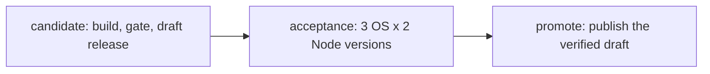

# Release operations

This project publishes two independent things: the reference database, as GitHub releases tagged `db-v<major>.<minor>.<patch>`, and the npm package, tagged `v<version>`. Data updates need only a database release. Installed servers pick up a new database on their next update check, without a package release.

## Rules for every release

- Release assets are immutable. Never overwrite an asset, edit a published database, or reuse a tag for different contents. A correction is a new version that passes every gate again. GitHub enforces this: the repository enables immutable releases, and the `Release tags` ruleset blocks moving or deleting any tag.
- Release tags are never reused, including tags of deleted or failed drafts.
- Keep old database releases available; older package majors still download them.

## Database releases

### Authorize publication

The [database release workflow](../.github/workflows/database-release.yml) refuses to publish until the repository owner sets up the `database-publication` environment:

1. Add the repository owner as the environment's only required reviewer. The release script reads the environment through the GitHub API and fails without this rule.
2. Disable administrator bypass and restrict deployments to `main`.
3. Add the environment secret `DATABASE_RELEASE_AUTHORIZATION` with the value `owner-authorized`. Do not create a repository or organization secret with that name.

The owner then approves each protected job: the candidate build and the promotion.

### How the workflow runs

The workflow runs on pushes to `main` that touch `data/`, `build/`, `scripts/`, `src/`, `tests/fixtures/acceptance.json`, `package.json`, `pnpm-lock.yaml`, or the workflow itself. Runs are serialized. You can also run it manually, with the `allow-shrink` input when a count drop is intentional.



1. **candidate** builds the complete reference, downloads the previous published database, runs the release gate, packs the npm tarball, and uploads the database as a draft release.
2. **acceptance** downloads the actual draft asset, checks its digest, and runs the cited acceptance fixtures through the packed CLI on Ubuntu, macOS, and Windows with Node 24.15.0 and the current Node release. All six runs must pass.
3. **promote** publishes the same draft, after checking its tag and digest again.

A failed run leaves its draft unpublished, and its version stays reserved. After investigating, an authorized operator may delete the failed draft before retrying. Never delete or replace a published asset to make a retry work.

Release metadata may contain null digests for unrelated assets. The selected database asset must still have a valid SHA-256 digest, and newly uploaded assets must match their local file hashes.

### Release gate

`scripts/release-gate.ts` checks the candidate database against the previous published one. It fails on:

- A failed SQLite integrity check, missing source tables, unresolved source rows, or a missing or empty provenance manifest.
- Missing Record kinds or Link relations, or names outside the known vocabulary.
- Search index counts that do not match their tables.
- Any table whose row count drops more than 5 percent, unless `--allow-shrink` is passed. The override waives this check only.
- Table contents that changed while every input pin stayed the same.
- A compressed asset over 250 MB, or one that does not decompress to the candidate.

The gate also assigns the database version by comparing the candidate with the previous release. Removing a table, changing a column type, removing a Record kind, or giving an existing source row a different Record ID is a major bump. Adding a table, column, or Record kind is a minor bump. Anything else is a patch. The version is then raised above every version already used in that major, including drafts, prereleases, and plain Git tags. A major bump needs a new package major, because each package major accepts one schema major.

Stable-ID comparisons use temporary, per-source key projections; neither database's schema nor source rows are modified.

### Prepare a candidate locally

The release commands need these variables:

```sh
export GITHUB_REPOSITORY=denisdasilvarocha/wotlk-mcp
export GITHUB_TOKEN=<token with access to this repository's releases>
```

1. Build into a new directory:

   ```sh
   vp run build ./candidate
   ```

2. Download the newest published database and list every reserved version:

   ```sh
   node scripts/database-release.mjs previous previous.sqlite versions.json
   ```

3. Run the gate, write the version, and recompress the asset:

   ```sh
   vpx scripts/prepare-reference.ts candidate previous.sqlite --used-versions=versions.json
   ```

   If no database has ever been published, omit `previous.sqlite`. The command updates `wotlk.sqlite.br` and `build-report.json`, and writes `gate.json`.

A local candidate is for investigation only. Publication always goes through the workflow, which tests the uploaded draft asset.

### Acceptance

The acceptance command runs the packed CLI against a candidate database and checks the cited fixtures in `tests/fixtures/acceptance.json`:

```sh
vp pm pack
vpx scripts/acceptance.ts wotlk-mcp-1.0.0.tgz candidate/wotlk.sqlite tests/fixtures/acceptance.json
```

The World Data fixtures are unapproved candidates, so the command fails until a maintainer reviews them and records approval in `data/world-acceptance-approval.json`:

| Field             | Value                             |
| ----------------- | --------------------------------- |
| `status`          | `approved`                        |
| `reviewer`        | Reviewer name                     |
| `date`            | ISO date of the review            |
| `record`          | URL of a durable review record    |
| `fixtures_sha256` | SHA-256 of the exact fixture file |
| `world_cases`     | Every approved World Data case ID |

Any change to the fixture file needs a new approval.

## npm package releases

The [release workflow](../.github/workflows/package-release.yml) uses [release-please](https://github.com/googleapis/release-please). Every push to `main` opens or updates a release pull request (`chore(main): release X.Y.Z`) that sets `version` in `package.json` and adds a `CHANGELOG.md` entry from the pull request titles merged since the last release. `feat` bumps the minor version, `fix` the patch version, and a breaking change (`!` or a `BREAKING CHANGE:` footer) the major version. Commits that only touch `.github/`, `build/`, `data/`, `docs/`, `scripts/`, or `tests/` do not count, because they do not change the package; `release-please-config.json` lists these paths.

The workflow authenticates as the repository's GitHub App (variable `APP_CLIENT_ID`, secret `APP_PRIVATE_KEY`) so release pull requests run CI. When a merge creates a release draft, the same workflow starts the `publish` job. Dependabot auto-merge uses the App to trigger `main` workflows too. It requires the private key in Dependabot secrets and queues only verified minor or patch updates behind `ci-ok` and `pr-title`.

### One-time npm setup

npm trusted publishing requires an existing package. This setup is done; it is recorded here in case the trust configuration must be recreated:

1. The unscoped `wotlk-mcp` package was created by publishing a placeholder `0.0.0` by hand, outside the repository; npm also added its own `0.0.0-stage` placeholder for the new package. Both are deprecated and contain no server.
2. The package has a GitHub Actions trusted publisher for `npm publish` (npm always allows `npm stage publish` too): user `denisdasilvarocha`, repository `wotlk-mcp`, workflow `package-release.yml`, no environment, no dist-tag management. To recreate it, run `npm trust github wotlk-mcp --file package-release.yml --repo denisdasilvarocha/wotlk-mcp --allow-publish` with an account that uses two-factor authentication. npm discards a new trust configuration that is not used within two days.

### Publish a version

1. Publish a compatible database release first.
2. If the schema major changed, the pull request that changes it updates both `acceptedSchemaMajor` in `src/schema.ts` and `wotlkSchemaMajor` in `package.json`, and marks its title as breaking (`feat!: ...`) so the release is a new package major. A breaking change to a tool's parameters or output is also marked breaking.
3. Merge the release pull request. To choose the version yourself, add a `Release-As: X.Y.Z` line to the body of any pull request merged before it.

Merging creates the `v<version>` tag and a draft release. The `publish` job then runs `scripts/check-package-release.mjs`, which fails if:

- The tag does not equal `v` plus the `package.json` version.
- The two schema-major values disagree.
- The npm package does not exist, or this version is already published.
- An earlier version with the same package major used a different schema major.
- No published database exists for the package's schema major, or its asset fails the digest or schema check.

The job then packs the server, runs the package tests, attests the npm tarball, uploads it to the draft release, publishes it with `npm publish` from the tarball's staging directory, and publishes the release. Publishing outside the checkout keeps npm's publication step separate from the checkout's pnpm `devEngines` requirement.

If the job fails before `npm publish`, fix the cause and rerun it; the draft still accepts the tarball. If the check cannot pass for this version, leave the tag in place and release a new patch version. If npm publication succeeds but publishing the release fails, do not rerun the job: npm rejects republishing a version. Publish the draft instead with `gh release edit vX.Y.Z --draft=false --latest`.

Merging the release pull request changes `package.json`, which also starts the database release workflow. Decline its deployment approval when no database release is due.

## Roll back a database release

Rollback changes which release clients discover. It never changes published bytes. Get owner authorization first, and confirm that an earlier compatible database release is still published.

Set the operator environment:

```sh
export GITHUB_REPOSITORY=denisdasilvarocha/wotlk-mcp
export GITHUB_TOKEN=<token with write access to releases>
export DATABASE_RELEASE_AUTHORIZATION=owner-authorized
```

Look up the release ID for the bad tag, replacing `db-vX.Y.Z`:

```sh
gh api "repos/$GITHUB_REPOSITORY/releases/tags/db-vX.Y.Z" --jq '{id,tag_name,draft,prerelease}'
```

Then either mark it as a prerelease, which keeps it for investigation (preferred):

```sh
node scripts/database-release.mjs rollback RELEASE_ID db-vX.Y.Z prerelease
```

Or, with explicit authorization, delete the release:

```sh
node scripts/database-release.mjs rollback RELEASE_ID db-vX.Y.Z delete
```

Deleting a release does not delete its Git tag; leave the tag in place so the version is never reused. Running servers keep their current database. Online clients switch to the newest remaining release after their next update check and restart; offline clients keep their cached copy. Tell users about the withdrawal and its limits.

## Client-input release

Release `client-inputs-12340-engb-1` holds the build inputs: DBC files, Interface source, and the native registration dump, but no client executable. Its asset `client-inputs-12340-engb-1.tar.gz` has SHA-256 `9f57598199dd2e9b185c1f3e14f42ba59b10f11b30f2e672d3554cebbe191136`, and `build/sources/index.ts` pins its manifest hash. It was published once and is not part of the database or package workflows. Never replace its asset; changed inputs need a new release name. It was published before the repository enabled immutable releases, so GitHub does not lock its asset.
